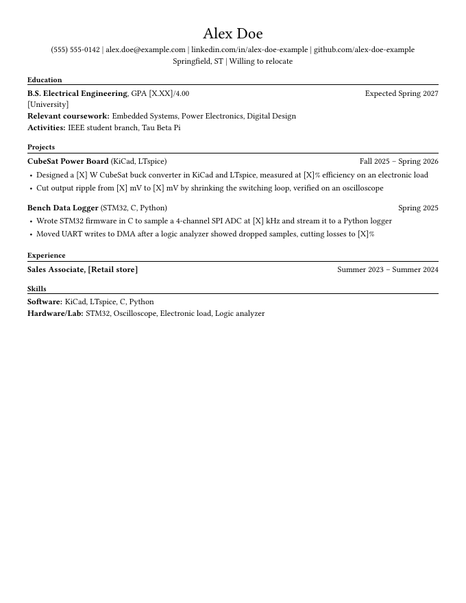

<picture>
  <source media="(prefers-color-scheme: dark)" srcset="docs/brand/resume-generator-lockup-dark-outlined.svg">
  
</picture>

Turn one JSON file into a one-page PDF resume. You write the content in `resume.json`, and the script does the layout and fits it onto a single page. A file with `"document": "cv"` in its settings builds a CV of up to two pages instead (see [Building a CV](#building-a-cv)).

This project is a companion to [eeprep.com](https://eeprep.com). It was built for engineering students and follows the advice on [eeprep's resume page](https://eeprep.com/advice/resume/), but it works for any field.

## Download

Get the latest zip from the [releases page](https://github.com/edwardasilva/resume-generator/releases/latest), unzip it, edit `resume.json` (see the field guide below) and run `./run`. It writes the PDF named after the `name` in `header`, such as `Alex-Doe-Resume.pdf`.

`./run` needs Python 3.9 or newer and LuaLaTeX. If either is missing, it says what it will install and asks before it uses `sudo`. On Linux the install command starts with `sudo`, so `sudo` has to be installed. It supports Fedora (dnf), Debian, Ubuntu and WSL (apt), and macOS (Homebrew). Run `./run --yes` to skip the question. It is also skipped when `CI=true` is set. The fonts come with the project in `fonts/`, so no font packages are needed, and the PDF looks the same on every system. The fonts cover accented Latin letters, basic Greek letters and common math symbols such as Ω, ±, ≤ and ×. Chinese, Japanese and Korean text is not covered. `times` and `arial` also lack Cyrillic and accented Greek letters. If the text holds a character the chosen font has no glyph for, the build stops and names it, instead of leaving it blank in the PDF.

To work from the repository instead, clone it and run `./run`. The first run copies `examples/alex.json` to `resume.json`. Git ignores `resume.json` and the `*-Resume.pdf` file in the top folder, so your personal details stay out of the repository.

To build any other file, pass it as an argument: `./run examples/new-grad.json` writes `examples/Alex-Doe-Resume-new-grad.pdf` next to it. The PDF is named `[Name]-Resume.pdf` after the header name, or `Resume.pdf` if there is none. Any file other than `resume.json` and `alex.json` adds its own name, as in `[Name]-Resume-[file].pdf` (a leading `resume-` is dropped, so `resume-firmware.json` writes `[Name]-Resume-firmware.pdf`), so two files for one person don't overwrite each other.

Build only JSON files you trust. The LaTeX build runs with shell escape off, and the JSON has no field that names a file, so text such as `\input{/etc/passwd}` prints as plain text and nothing on your machine is read or run because of it. Two things to know before you build a file from someone else: `./run` may ask for `sudo` to install missing packages, and the PDF overwrites any file with the same name beside the input.

## Examples

Each example in `examples/` is a made-up resume and the PDF built from it, from nearly empty to completely full.

| File | Who it describes | PDF |
| --- | --- | --- |
| `alex.json` | The starting point. It follows the finished example on eeprep's resume page. The student graduates in 2027 and has two projects, a sales job with two bullets and two skill lines. Every tool in the skill lines appears in a bullet. `[X]` marks a number you measure. | [Alex-Doe-Resume.pdf](examples/Alex-Doe-Resume.pdf) |
| `first-year.json` | A first-year student with one class project, a grocery job with two bullets and a few skills. The page has room left at the bottom. | [Alex-Doe-Resume-first-year.pdf](examples/Alex-Doe-Resume-first-year.pdf) |
| `sophomore.json` | A second-year student with two projects, an electrical lead role in a robotics club and a barista job with two bullets, because the page has room. | [Alex-Doe-Resume-sophomore.pdf](examples/Alex-Doe-Resume-sophomore.pdf) |
| `new-grad.json` | A new graduate with two internships, two projects and certifications. Experience comes right after Education, and the resume uses the `times` font. | [Alex-Doe-Resume-new-grad.pdf](examples/Alex-Doe-Resume-new-grad.pdf) |
| `packed.json` | A graduating student with three engineering roles, a one-line job, three projects and long skill lists, in the `arial` font. The script tightens it to fit. | [Alex-Doe-Resume-packed.pdf](examples/Alex-Doe-Resume-packed.pdf) |
| `alex-cv.json` | A two-page CV, not a resume. The same student with honors, scholarships, four jobs with bullets, four projects, certifications, activities and organizations. | [Alex-Doe-CV.pdf](examples/Alex-Doe-CV.pdf) |

## Field guide

JSON doesn't allow comments, so this section explains each field. A blank field (`""`) or an empty list (`[]`) is left out of the PDF. Text goes in quotes, `true` and `false` go without them, and lists such as `bullets` go in brackets, even with one item. The build stops and names any field with the wrong kind of value. It prints a note for any field name it doesn't read, such as a misspelled one, and for any section with content that `sectionOrder` leaves out.

The phone, email, LinkedIn, GitHub and website in the header are links, except the example values `linkedin.com/in/your-name` and `github.com/your-username` (and any address under them), which print as plain text so they never point at a real account. Replace them with your own. The email opens a new message and the phone number dials. Any entry can also have a link:

| Field | What to put | Example |
| --- | --- | --- |
| `url` | Optional on any education, project or experience entry. The school, project title or employer becomes a link, shown in the normal text color. To link a skill, coursework or activity item, write it as `{"name": "...", "url": "..."}`. Inside a bullet, `[text](url)` links the text. The URL may contain parentheses, as in `en.wikipedia.org/wiki/Buck_(converter)`. Links must be web addresses (`https://` is added if missing), `mailto:` or `tel:`. | `github.com/your-username/cubesat-buck-converter` |

### `settings`

| Field | What to put | Example |
| --- | --- | --- |
| `sectionOrder` | Order of the sections. A section left out of the list is left off the page. | `["education", "projects", "experience", "skills"]` |
| `font` | `libertinus`, `times` or `arial`. Leave it out to use `libertinus`. | `"libertinus"` |
| `dateStyle` | The date style for each section: `semester` (Fall 2025), `month` (Sep 2025, Sept 2025 or September 2025; pick one spelling and keep it) or `year` (2025), which suits a CV's honors, scholarships and certifications. Every date in a section must use that section's style. The build stops if one doesn't. A section left out uses `semester`. | `{"education": "month", "projects": "semester", "experience": "month"}` |

Common orders, from the [r/EngineeringResumes wiki](https://www.reddit.com/r/EngineeringResumes/wiki/index/): a student or new graduate with no technical work experience goes education, projects, experience, skills. One with an internship or other technical work goes education, experience, projects, skills. Once you start a full-time job, go experience, skills, education. Inside each section, put the most relevant or impressive entry first. Use one date style inside each section. Date jobs by month. Projects can use semesters, but use months if a project runs longer than a year.

Acceptable fonts for `settings.font`:

| Value | Font | Looks like |
| --- | --- | --- |
| `libertinus` | Libertinus Serif (default) | A classic book serif |
| `times` | TeX Gyre Termes | A free font close to Times New Roman. The PDF embeds TeX Gyre Termes from `fonts/`, not Times. |
| `arial` | TeX Gyre Heros | A free font close to Helvetica and Arial. The PDF embeds TeX Gyre Heros from `fonts/`, not Arial. |

### `header`

| Field | What to put | Example |
| --- | --- | --- |
| `name` | The name you want recruiters to use. It also fills the PDF's title (`Alex Doe Resume`) and author properties. | `Alex Doe` |
| `phone` | Your phone number. No label such as "Cell:". | `(555) 555-0142` |
| `email` | An address you check every day. A school address is fine. | `alex.doe@example.com` |
| `linkedin` | Your profile URL without `https://`. | `linkedin.com/in/your-name` |
| `github` | Only if it holds work you're proud of. | `github.com/your-username` |
| `website` | A personal site or portfolio, if you have one. | `example.com/~alex-doe` |
| `location` | City and state. | `Springfield, ST` |
| `relocate` | `true` adds "Willing to relocate". | `true` |

### `education`

A list. Most students have one entry. Add a second for a master's degree.

| Field | What to put | Example |
| --- | --- | --- |
| `degree` | Degree and major. | `B.S. Electrical Engineering` |
| `gpa` | `N.NN/4.00`. List it when a posting sets a minimum you meet. | `3.62/4.00` |
| `school` | Your university. | `Example State University` |
| `gradDate` | Your graduation date, in the education date style. Use a month, with `education` set to `month` in `dateStyle`, and add "Expected" if you haven't graduated. It goes at the right of the degree line. If the degree line is too long to share it, the build moves the date to the school line. | `Expected May 2027` |
| `start`, `end` | CV only. A range of dates for study with no graduation, in the education date style. A CV prints it when `gradDate` is blank. A resume shows only `gradDate`, so the build notes a `start` or `end` it leaves out. | `Sep 2023`, `May 2025` |
| `coursework` | Upper-level courses that match the jobs you want. | `["Power Electronics", "Embedded Systems"]` |
| `activities` | Clubs and honor societies. Put real build work in `projects`. | `["IEEE student branch"]` |

### `projects`

A list, best project first. This is where you show what you can do.

| Field | What to put | Example |
| --- | --- | --- |
| `title` | A plain name for what you built. Don't use the word "project". | `FPGA Audio Equalizer` |
| `tools` | Tools, languages and parts you used. Shown in parentheses after the title, like `CubeSat Power Board (KiCad, LTspice)`. | `["Verilog", "Vivado", "MATLAB"]` |
| `start`, `end` | Dates in the projects date style. A blank `end` or `Present` means ongoing. Matching dates show once. | `Spring 2025` |
| `bullets` | One to four lines on what you did and what happened. | see below |
| `hide` | `true` leaves the entry out without deleting it. | `true` |

### `experience`

A list, most recent first.

| Field | What to put | Example |
| --- | --- | --- |
| `title`, `company` | Your role and where you worked. | `Power Subsystem Lead`, `Example State CubeSat Team` |
| `location` | City and state, or blank. | `Springfield, ST` |
| `start`, `end` | Dates in the experience date style. A blank `end` or `Present` means ongoing. | `Sep 2024`, `Present` |
| `engineering` | `true` for engineering work. `false` marks another job: its bullets print unless the resume has an engineering job and the rest of the resume fills the page. Then it drops to one line, and the build notes the bullets it leaves out. | `false` |
| `bullets` | Same rules as project bullets. | |
| `hide` | `true` leaves the entry out. | |

A non-engineering job still shows you can hold a job. Give it one or two bullets with a number in them. Once your engineering work fills the page, one line is enough. The build checks this for you: it first fits the page without that job's bullets, and keeps them if the page still fits with them at the same text size.

### `skills`

| Field | What to put | Example |
| --- | --- | --- |
| `software` | Tools and languages, most important first. Write `C, C++`, not `C/C++`. | `["KiCad", "LTspice", "Python"]` |
| `hardwareLab` | Lab equipment and hardware you can use without help. | `["Oscilloscope", "Electronic load"]` |
| `certifications` | Only ones you can prove. | `[]` |

The build prints every name as you write it and never changes capitalization, so `LTspice`, `FPGA` and `Oscilloscope` all stay as typed. Capitalize tools the way their makers do.

Put every listed skill in a bullet or a project's `tools`. Leave out soft skills such as "communication". Show them in the bullets instead.

## Building a CV

A CV is a second kind of document built from the same kind of JSON file. Add `"document": "cv"` to `settings` and run `./run` on the file, as in `./run examples/alex-cv.json`. It writes `[Name]-CV.pdf` next to the file (a `cv` or `resume` in the file name adds nothing, so `alex-cv.json` writes `Alex-Doe-CV.pdf`, and `firmware-cv.json` writes `Alex-Doe-CV-firmware.pdf`). `settings.document` is `"resume"` when left out, and the one-page resume works as before. The CV has its own template, `cv.tex`.

What differs from the resume:

- **Two pages at most.** The build uses the same steps as the resume, 11 pt text down to 10 pt, but allows two pages. If the CV still doesn't fit at 10 pt, the build stops and says about how many lines to cut. If it fits with room left, the spacing grows until the used pages are full, and a CV that fits on one page stays on one.
- **Everything in the file prints.** Nothing is dropped to make it fit. An entry with `"hide": true`, and a section that `sectionOrder` leaves out, are the only things left off. A job prints its bullets whether or not `engineering` is `true`.
- **More sections.** The CV reads `education`, `experience`, `projects` and `skills` as the resume does, plus `honors`, `scholarships`, `certifications`, `activities` and `organizations`. An education entry also takes `location`, `thesis` and `honors` (a list). Without `sectionOrder`, the sections come in this order: education, honors, scholarships, experience, projects, skills, certifications, activities, organizations.
- **Titles and labels come from the file.** `settings.sectionTitles` renames a section, such as `{"honors": "Honors and Awards"}`, and `settings.labels` changes the words before a list or a value: `gpa`, `coursework`, `activities`, `honors`, `thesis`, `software`, `hardwareLab`, `skillsCertifications` and `relocate`. A name left out keeps its default.

The new sections are lists of records with the same fields:

| Field | What to put | Example |
| --- | --- | --- |
| `title` | The name of the honor, scholarship, certification, activity or role. | `Example Foundation Engineering Scholarship` |
| `organization` | Who gave it, or where it took place. | `Example Foundation` |
| `location` | City and state, or blank. | `Springfield, ST` |
| `date` | One date, in the section's date style. | `2026` |
| `start`, `end` | A date range instead of `date`. A blank `end` or `Present` means ongoing. | `Fall 2024`, `Present` |
| `url` | Makes the title a link. | `example.org/scholarship` |
| `bullets` | Optional lines of detail. | |
| `hide` | `true` leaves the record out. | |

The text check, the notes about short bullets, the fonts and the link rules work as for the resume.

## Writing good bullets

Start with a past-tense verb, say what you built or changed, and end with a result you measured:

> Cut output ripple from 80 mV to 25 mV peak to peak, measured on an oscilloscope, by redesigning the 4-layer PCB in KiCad with a solid ground plane and a tighter switching loop

- Use a real number you measured or can defend in an interview. Don't make one up.
- Don't start with "Helped", "Assisted", "Worked on" or "Utilized".
- Don't bold words inside a bullet.

## Fitting on one page

The layout follows the rules on [eeprep's resume page](https://eeprep.com/advice/resume/): text from 10 to 11 pt, margins of 0.5 in, line spacing of at least 1.07, the same gap between every pair of sections, and a page that is full but not crammed.

`build.py` finds the largest text that fits. It starts at 11 pt text with 0.5 in margins, steps the text down to 10 pt while the margins stay at 0.5 in, and keeps the first layout that fits on one page. It then fills the page. Line spacing, section gaps and entry gaps grow together, in proportion, until the page is full. They go from compact (1.07 line spacing, 7 pt section gaps) up to roomy (1.15 and 10 pt). Spacing never shrinks below compact to fit more.

If the page still has more than 3 empty lines at roomy spacing, the build notes it. eeprep's page counts empty space as wasted, so add a class project, lab work or a bullet instead. The build also notes any wrapped bullet whose last line fills less than half the line. Cut the bullet by a line, or add a detail that fills most of the last one.

If the resume doesn't fit at 10 pt, the build stops and says about how many lines to cut. Drop a coursework item first, then the weakest bullet, or add `"hide": true` to an older project.

## Checking the PDF

To look at the result, run `pdftoppm -png -r 80 Alex-Doe-Resume.pdf page` (it comes with poppler) and open `page-1.png`. Check that it is one page and that nothing is cut off.

## Checking the text

Applicant tracking systems read the PDF's text, not its look. The build checks its text with `pdftotext`, the way many applicant tracking systems read text. No applicant tracking system was tested. When `pdftotext` is installed, each build extracts the text. Install poppler to get it, with `brew install poppler`, `sudo apt-get install poppler-utils` or `sudo dnf install poppler-utils`. The build checks that the name, contact items, section titles, entries, bullets and dates all come out whole and in reading order, with no broken ligatures or unreadable glyphs. Problems print as a warning. Set `RESUME_TEXT_CHECK=strict` to make them an error. Words never break with a hyphen across lines, because a split word can't be found by a keyword search.

## Writing the content with an AI tool

If you draft `resume.json` with Claude Code, Cursor, or another coding agent, give it [the eeprep resume skill](https://eeprep.com/skills/eeprep-resume/README.md) first. It teaches the agent the layout rules this tool follows, the bullet pattern, and how to tailor a version to one posting. It never invents a number, a tool, or a result you did not give it. It writes `[X]` where a measurement belongs and tells you to go measure it.

## Before applying

A referral helps more than a good resume. Before you apply, ask someone who knows your work for one. For more on resumes, referrals and applying for engineering jobs, see [eeprep.com](https://eeprep.com) and its [resume page](https://eeprep.com/advice/resume/).

## Limits

- The paper is US Letter. There is no A4 setting.
- The resume is one page. If the content does not fit, the build stops. There is no second page. A CV is the exception: it may take two, and no more.
- The resume's sections are `education`, `projects`, `experience` and `skills`, with those titles. You can reorder them in `settings.sectionOrder`, but you cannot add or rename one. Any other name stops the build with `unknown section`. A CV has the five more sections above, and can rename them.
- In a resume that has an engineering job, a job with `"engineering": false` prints as one line when the rest of the resume fills the page, and its bullets are left out. A CV always prints them. The build keeps or drops the bullets of every such job together, never some of them.
- The `libertinus` font covers Latin, Greek and Cyrillic. No font covers Chinese, Japanese or Korean. `times` and `arial` also lack Cyrillic and accented Greek letters. The build stops and names any character the font cannot draw.
- `./run` installs missing tools only on Fedora, Debian, Ubuntu (including WSL) and macOS. On other systems, install Python and LuaLaTeX yourself.

## Contributing

To suggest an idea or open a pull request, see [CONTRIBUTING](https://github.com/edwardasilva/resume-generator/blob/main/.github/CONTRIBUTING.md).

Only the repository owner cuts releases.

To report a vulnerability, use GitHub's private vulnerability reporting on this repository. Do not open a public issue.

## License

The repo has two licenses, one for content and one for code.

Content is licensed under [CC BY 4.0](https://creativecommons.org/licenses/by/4.0/) (full text in [LICENSE-CONTENT](LICENSE-CONTENT)). You may share and adapt it if you credit [resume-generator contributors](https://github.com/edwardasilva/resume-generator) and link the license. Content means the example resumes and sample data in `examples/`, the docs, and the logo. The docs are every Markdown file in the repo: `README.md`, `AGENTS.md`, `examples/README.md`, `fonts/README.md` and the Markdown files in `.github/`. The logo is the two SVG files in `docs/brand/`.

A resume you build with this tool, including one started from an example, is yours and needs no credit.

Code is licensed under the [MIT License](LICENSE). Code means everything else, including `build.py`, `resume.tex`, `cv.tex`, `run`, `pyproject.toml`, `tests/`, and the scripts and workflows in `.github/`.

The fonts in `fonts/` keep their own licenses: Libertinus Serif is under the SIL Open Font License 1.1 ([fonts/OFL.txt](fonts/OFL.txt)), and TeX Gyre Termes and TeX Gyre Heros are under the GUST Font License ([fonts/GUST-FONT-LICENSE.txt](fonts/GUST-FONT-LICENSE.txt)), which is the LaTeX Project Public License 1.3c or later ([fonts/lppl.txt](fonts/lppl.txt)). The license texts and upstream notices in `fonts/` are their authors' own and fall under neither license above. See [fonts/README.md](fonts/README.md) for where each file comes from and who holds its copyright.
